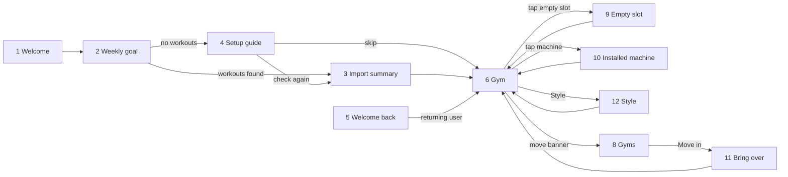

# Fitheon

An iPhone app that turns real workouts into a gym-building game.

Fitheon reads the workouts you already record in Apple Health (from Strong, Hevy, Strava, an Apple Watch, or any app that saves there). Each workout earns coins and XP. You spend them on machines, fill your garage, and move up through four gyms to an elite club. There is no manual logging and no streaks, and nothing you have earned is ever taken away.

## Mockups

These are the screens of the interactive design prototype. The numbers under "Flows" refer to them.

### First launch

<p>
  
  
  
  
</p>

1. **Welcome:** What the app does
2. **Weekly goal:** Pick active days per week
3. **Import summary:** The last 7 days of workouts become your starting coins and XP
4. **Setup guide:** Shown instead of 3 when Apple Health has no workouts

### Your gym

<p>
  
  
  
  
</p>

5. **Welcome back:** What you earned since you last opened the app
6. **Gym:** The home screen: level, coins, weekly goal and slots
7. **Gym, next gym unlocked:** A banner appears once you reach the level for the next gym
8. **Gyms:** The four gyms and what the next one needs

### Slots and style

<p>
  
  
  
  
</p>

9. **Empty slot:** Choose a machine to buy
10. **Installed machine:** Quality tier, upgrade rules and swaps
11. **Bring over:** In a new gym, copy a machine from the old one for free
12. **Style:** Floor and wall styles

### Activity and settings

<p>
  
  
</p>

13. **Activity:** Every imported workout, what it earned, and why some did not count
14. **Settings:** Weekly goal, Apple Health sync and account

### Flows



- **First launch:** Welcome → Weekly goal → Import summary → Gym. If Apple Health has no workouts from the last 7 days, the Setup guide replaces the Import summary.
- **Returning:** Welcome back shows the new coins and XP, then opens the Gym. Reaching level 6 adds the banner to move to the Neighbourhood gym.
- **Tab bar:** Gym, Gyms, Activity and Settings are reachable from each other at any time.

## How the game works

- **Coins** come from workout minutes: `round(counted_minutes × multiplier × 2)`. The multiplier depends on the workout type and its intensity. Workouts under 10 minutes do not count, and at most 120 minutes count per day.
- **XP** comes from consistency: 20 XP for the first counted workout of a day and 50 XP for reaching your weekly goal.
- **Gyms:** Garage, Neighbourhood gym, Commercial gym and Elite club. Each has a fixed set of slots. You choose the machine for each slot and upgrade it through four quality tiers (Basic, Standard, Commercial, Elite). Each gym caps the quality you can reach in it.
- **Moving on** needs a level and coins, not a finished gym. Old gyms stay as you left them.

The full rules are in the [specification](Fitheon-Specification-v2.md). The original pitch is in [Fitheon-idea.md](Fitheon-idea.md).

## Repository

| Path | What it is |
|---|---|
| `packages/engine` | Turns workouts into coins and XP |
| `packages/catalog` | Gyms, slots, machines, styles and prices |
| `packages/game` | Game state and the actions a player can take |
| `tools/sim` | Economy simulator and command line tool |
| `dokumentacija/mockups` | The screenshots used in this README |

All rules live in these shared TypeScript packages so that the app, the server and the tests use the same code.

## Getting started

Requires Node 22.

```sh
npm install
npm test            # run all tests
npm run typecheck   # type-check the packages
npm run november    # score a real week of workouts (the test fixture)
npm run simulate    # simulate the economy; add `-- 12` to set the number of weeks
```

## Planned stack

- **App:** React Native with Expo, iPhone only.
- **Backend:** Supabase. The app reads its own rows; every write goes through an Edge Function that uses the shared rule packages.
- **Workout data:** Apple Health (HealthKit).
