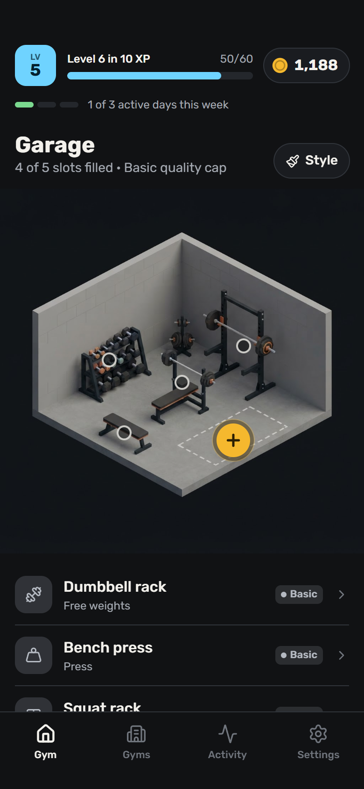
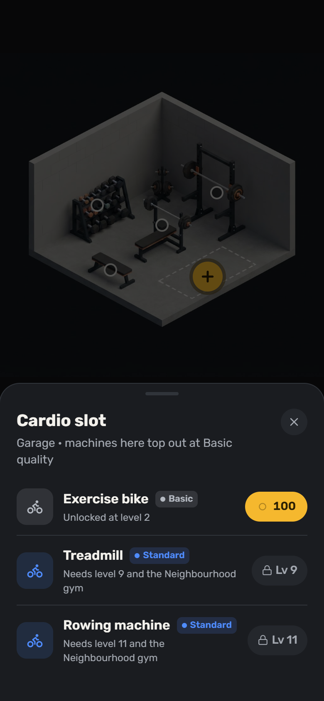
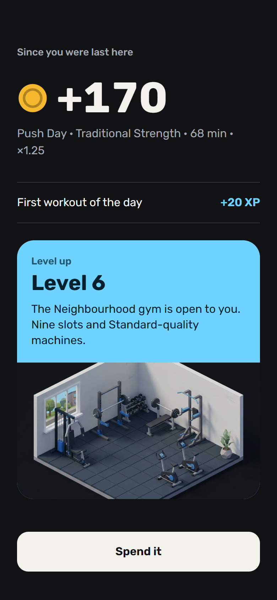
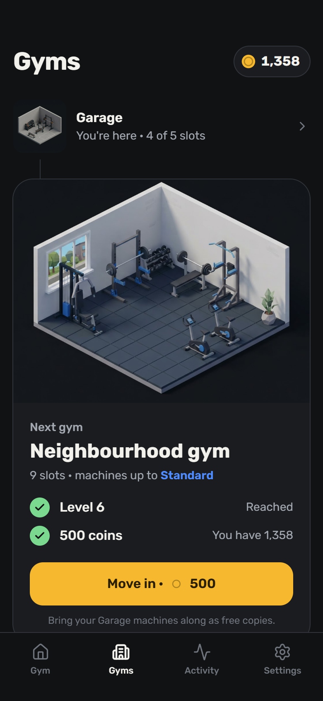

# Fitheon

[](https://github.com/gubicnino/Fitheon/actions/workflows/ci.yml)

Aplikacija za iPhone, ki resnične treninge spremeni v igro gradnje fitnesa.

Fitheon prebere treninge, ki jih že beležite v Apple Health (iz aplikacij Strong, Hevy, Strava, z uro Apple Watch ali iz katerekoli aplikacije, ki shranjuje tja). Vsak trening prinese kovance in XP. Z njimi kupujete naprave, opremite svojo garažo in napredujete skozi štiri fitnese do elitnega kluba. Ročnega beleženja ni, nizov ni in nič, kar ste zaslužili, se vam nikoli ne odvzame.

## Mockupi

Glavni zasloni interaktivnega oblikovalskega prototipa:

<p>
  
  
  
  
</p>

1. **Fitnes:** domači zaslon z ravnjo, kovanci, tedenskim ciljem in mesti
2. **Prazno mesto:** izbira naprave za nakup
3. **Povzetek ob vrnitvi:** kaj ste zaslužili od zadnjega odprtja aplikacije
4. **Fitnesi:** štirje fitnesi in zahteve za naslednjega

Vseh 14 zaslonov in navigacijska karta so v [dokumentacija/03-mockupi.md](dokumentacija/03-mockupi.md).

## Kako igra deluje

- **Kovanci** izhajajo iz minut treninga: `round(upoštevane_minute × množitelj × 2)`. Množitelj je odvisen od vrste treninga in njegove intenzivnosti. Treningi, krajši od 10 minut, ne štejejo, na dan pa se upošteva največ 120 minut.
- **XP** izhaja iz rednosti: 20 XP za prvi upoštevani trening v dnevu in 50 XP za dosežen tedenski cilj.
- **Fitnesi:** Garaža, Sosedski fitnes, Komercialni fitnes in Elitni klub. Vsak ima vnaprej določena mesta. Za vsako mesto izberete napravo in jo nadgrajujete skozi štiri kakovostne stopnje (Osnovna, Standardna, Komercialna, Elitna). Vsak fitnes omejuje najvišjo kakovost, ki jo lahko v njem dosežete.
- **Selitev naprej** zahteva raven in kovance, ne pa dokončanega fitnesa. Prejšnji fitnesi ostanejo takšni, kot ste jih pustili.

## Repozitorij

| Pot | Kaj je |
|---|---|
| `packages/engine` | Pretvori treninge v kovance in XP |
| `packages/catalog` | Fitnesi, mesta, naprave, slogi in cene |
| `packages/game` | Stanje igre in dejanja, ki jih lahko izvede igralec |
| `tools/sim` | Simulator ekonomije in orodje za ukazno vrstico |
| `dokumentacija/mockups` | Zaslonske slike, uporabljene v tem README |

Vsa pravila so v teh skupnih paketih TypeScript, tako da aplikacija, strežnik in testi uporabljajo isto kodo.

## Začetek

Potreben je Node 22.

```sh
npm install
npm test            # zažene vse teste
npm run typecheck   # preveri tipe v paketih
npm run november    # oceni resničen teden treningov (testni primer)
npm run simulate    # simulira ekonomijo; z `-- 12` nastavite število tednov
```

## Načrtovane tehnologije

- **Aplikacija:** React Native z Expo, samo za iPhone.
- **Zaledje:** Supabase. Aplikacija bere svoje vrstice; vsako pisanje gre skozi funkcijo Edge Function, ki uporablja skupne pakete s pravili.
- **Podatki o treningih:** Apple Health (HealthKit).

## Dokumentacija

Projektna dokumentacija je v mapi [dokumentacija/](dokumentacija/).

| Dokument | Kaj pokriva |
|---|---|
| [01-opis-projekta.md](dokumentacija/01-opis-projekta.md) | Problem, ciljna skupina, glavne funkcionalnosti in kaj je izven obsega |
| [02-primeri-uporabe.md](dokumentacija/02-primeri-uporabe.md) | Diagram primerov uporabe in štirje uporabniški scenariji |
| [03-mockupi.md](dokumentacija/03-mockupi.md) | Zasloni in navigacijska karta |
| [04-arhitektura.md](dokumentacija/04-arhitektura.md) | Arhitekturni diagram, podatkovni model in tehnologije |
| [Fitheon-Specification-v2.md](dokumentacija/Fitheon-Specification-v2.md) | Celotna produktna in tehnična specifikacija (v angleščini) |
