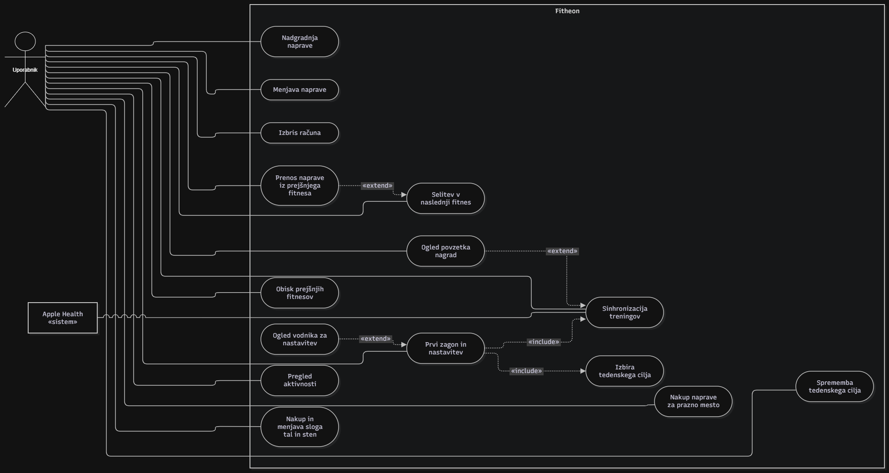

# Primeri uporabe

Dokument prikazuje, kdo uporablja Fitheon in kaj z njim počne: diagram
primerov uporabe in štirje uporabniški scenariji.

Vir: [Fitheon-Specification-v2.md](Fitheon-Specification-v2.md), poglavja
2–7. Opis funkcionalnosti je v [01-opis-projekta.md](01-opis-projekta.md).

## 1. Akterji

| Akter | Vloga |
|---|---|
| **Uporabnik** | Edini človeški akter. Trenira, pregleduje nagrade in s kovanci opremlja svoj fitnes. |
| **Apple Health** | Zunanji sistem. Hrani treninge, ki jih vanj zapišejo ura Apple Watch ali aplikacije, kot so Strong, Hevy in Strava. Fitheon iz njega samo bere. |

Aplikacija nima skrbniške vloge in nobene interakcije med uporabniki.

## 2. Diagram primerov uporabe

Pojasnila k povezavam:

- **Prvi zagon** vedno vključuje izbiro tedenskega cilja in prvo
  sinhronizacijo (uvoz zadnjih 7 dni).
- **Vodnik za nastavitev** se prikaže le, če prvi uvoz ne najde nobenega
  treninga.
- **Povzetek nagrad** se prikaže le, če je sinhronizacija prinesla nove
  nagrade.
- **Prenos naprave** je mogoč šele po selitvi v naslednji fitnes.
- **Sinhronizacijo** sproži uporabnik (odprtje aplikacije, »sinhroniziraj
  zdaj«) ali Apple Health v ozadju, ko se shrani nov trening.

## 3. Scenariji

### Scenarij 1: Prvi zagon

| | |
|---|---|
| **Akter** | Uporabnik, Apple Health |
| **Cilj** | Uporabnik začne igro z nagradami za treninge zadnjega tedna. |
| **Predpogoji** | Aplikacija je nameščena in še ni bila zagnana. |
| **Rezultat** | Uporabnik ima račun, izbran tedenski cilj in fitnes Garaža z začetno opremo. |

**Glavni tok**

1. Uporabnik odpre aplikacijo. Fitheon mu v ozadju ustvari anonimen račun;
   prijava ni potrebna.
2. Prikaže se pozdravni zaslon s kratko razlago igre.
3. Fitheon zaprosi za dovoljenje za branje treningov iz Apple Health;
   uporabnik ga odobri.
4. Uporabnik izbere tedenski cilj: število aktivnih dni na teden, od 1 do 7
   (privzeto 3).
5. Fitheon iz Apple Health uvozi treninge zadnjih 7 dni in jih nagradi po
   običajnih pravilih.
6. Prikaže se povzetek uvoza: upoštevani treningi, zasluženi kovanci in XP ter
   dosežena raven.
7. Uporabnik pride na domači zaslon: Garaža s privzetimi tlemi in stenami ter
   brezplačnim stojalom za ročke na svojem mestu. Ostala štiri mesta so prazna
   in vidno označena.

**Alternativni tokovi**

- **5a. Uvoz ne najde nobenega treninga.** Fitheon prikaže vodnik za
  nastavitev, ki pokaže, kako v aplikacijah Strong, Hevy, Strava in podobnih
  vklopiti zapisovanje v Apple Health. Uporabnik nato nadaljuje v Garažo z
  0 kovanci.
- **5b. Nekateri treningi niso upoštevani** (krajši od 10 minut, ročno
  vneseni, prekrivajoči se). Ne prinesejo nagrade; na zaslonu Aktivnost so
  prikazani sivo, z razlogom.

### Scenarij 2: Sinhronizacija po treningu

| | |
|---|---|
| **Akter** | Uporabnik, Apple Health |
| **Cilj** | Uporabnik za opravljen trening brez ročnega vnosa prejme kovance in XP. |
| **Predpogoji** | Prvi zagon je opravljen. Uporabnik je končal trening, ki ga je ura ali aplikacija za beleženje zapisala v Apple Health. |
| **Rezultat** | Trening je zabeležen, stanje kovancev in XP je povečano, nagrada je dokončna. |

**Glavni tok** (primer: 74,6 minute treninga moči, prvi trening tega dne)

1. Aplikacija za beleženje shrani trening v Apple Health.
2. Apple Health v ozadju prebudi Fitheon, ta pa strežniku pošlje povzetek
   treninga: vrsto, začetek, konec, trajanje in MET, če obstaja.
3. Strežnik preveri pravila (trajanje vsaj 10 minut, dnevna omejitev 120
   minut, ni ročno vnesen, se ne prekriva) in izračuna nagrado:
   74,6 min × 1,25 × 2 = **187 kovancev** ter **+20 XP** za prvi trening dneva.
4. Uporabnik prejme obvestilo, ubesedeno kot že prejeta nagrada:
   »Moč, 74 min: +187 kovancev«.
5. Uporabnik odpre aplikacijo. Prikaže se povzetek ob vrnitvi: trening,
   kovanci, XP ter morebitna nova raven in na novo odklenjene naprave.
6. Uporabnik zapre povzetek in pride v svoj fitnes, kjer lahko kovance takoj
   porabi.

**Alternativni tokovi**

- **2a. Sinhronizacija v ozadju se ne zgodi** (iOS jo odloži ali je telefon
  zaklenjen). Trening se sinhronizira, ko uporabnik odpre aplikacijo;
  nadaljuje se pri koraku 3, brez obvestila.
- **3a. Trening je krajši od 10 minut.** Zabeleži se brez nagrade in je v
  Aktivnosti prikazan sivo z razlogom »pod minimumom«.
- **3b. Dnevna omejitev je delno izkoriščena.** Upoštevajo se le preostale
  minute do 120.
- **3c. S tem treningom je dosežen tedenski cilj.** Uporabnik takoj prejme
  dodatnih +50 XP (enkrat na teden).
- **3d. Trening ni prvi tega dne.** Prinese kovance, ne pa XP.
- **4a. To je prva prejeta nagrada.** Fitheon šele zdaj zaprosi za dovoljenje
  za pošiljanje obvestil.
- **Sinhronizacija se ponovi.** Isti trening se nikoli ne nagradi dvakrat.

### Scenarij 3: Nakup in nadgradnja naprave

| | |
|---|---|
| **Akter** | Uporabnik |
| **Cilj** | Uporabnik zaslužene kovance spremeni v vidno izboljšavo fitnesa. |
| **Predpogoji** | Uporabnik ima kovance; v fitnesu je prazno mesto oziroma naprava, ki še ni na najvišji dovoljeni kakovosti. |
| **Rezultat** | Naprava je postavljena oziroma nadgrajena, kovanci so odšteti, sprememba je vidna na sliki fitnesa. |

**Glavni tok: nakup** (primer: bench press v Garaži)

1. Uporabnik na domačem zaslonu tapne označeno prazno mesto kategorije
   »potisk«.
2. Odpre se list mesta s seznamom naprav, ki jih to mesto sprejme. Odklenjene
   naprave imajo ceno, zaklenjene pa prikazujejo zahtevano raven.
3. Uporabnik izbere bench press osnovne kakovosti za 100 kovancev.
4. Strežnik preveri stanje kovancev in raven, odšteje kovance in napravo
   postavi na mesto.
5. List se zapre; bench press je viden v fitnesu, stanje kovancev v glavi
   zaslona je posodobljeno.

**Glavni tok: nadgradnja** (primer: isti bench press v Sosedskem fitnesu, uporabnik na ravni 7)

1. Uporabnik tapne mesto s postavljeno napravo.
2. List mesta prikaže napravo, njeno trenutno kakovost (Osnovna) in ceno
   naslednje stopnje (Standardna, 300 kovancev).
3. Uporabnik izbere nadgradnjo.
4. Strežnik preveri pogoje, odšteje kovance in napravo dvigne za eno stopnjo.
5. Naprava v fitnesu dobi videz nove kakovostne stopnje.

**Alternativni tokovi**

- **Premalo kovancev.** Nakup oziroma nadgradnja ni izvedena; uporabnik vidi,
  koliko kovancev potrebuje.
- **Naprava ali stopnja je zaklenjena z ravnjo.** Možnost je prikazana z
  zahtevano ravnjo in je ni mogoče izbrati.
- **Dosežena je najvišja kakovost, ki jo dovoli fitnes** (v Garaži Osnovna).
  Nadgradnja ni na voljo do selitve v naslednji fitnes.
- **Menjava naprave.** Uporabnik na zasedenem mestu izbere drugo napravo.
  Stara se ne izgubi: shrani se za to mesto z ohranjeno kakovostjo in vrnitev
  nanjo je brezplačna.

### Scenarij 4: Selitev v naslednji fitnes

| | |
|---|---|
| **Akter** | Uporabnik |
| **Cilj** | Uporabnik odklene večji fitnes z več mesti in višjo dovoljeno kakovostjo. |
| **Predpogoji** | Uporabnik je dosegel zahtevano raven naslednjega fitnesa in ima dovolj kovancev za selitev. |
| **Rezultat** | Naslednji fitnes je odklenjen in postane trenutni; prejšnji ostane nespremenjen. |

**Glavni tok** (primer: iz Garaže v Sosedski fitnes; raven 6, 500 kovancev)

1. Uporabnik doseže raven 6. Na domačem zaslonu se pojavi poudarjen gumb
   »Preseli se v naslednji fitnes«.
2. Uporabnik tapne gumb ali odpre zaslon Fitnesi, kjer vidi verigo svojih
   fitnesov in naslednjega z zahtevami: raven 6, 500 kovancev.
3. Uporabnik potrdi selitev.
4. Strežnik preveri raven in stanje kovancev, odšteje 500 kovancev in odklene
   Sosedski fitnes.
5. Prikaže se novi fitnes z 9 praznimi mesti ter privzetimi tlemi in stenami.
6. Uporabnik tapne prazno mesto. List mesta poleg naprav za nakup ponudi tudi
   naprave iz Garaže, ki ustrezajo kategoriji mesta.
7. Uporabnik izbere prenos. Naprava se brezplačno postavi kot kopija z enako
   kakovostjo; izvirnik ostane v Garaži.
8. Uporabnik preostala mesta sčasoma zapolni z nakupi.

**Alternativni tokovi**

- **Raven še ni dosežena.** Gumba za selitev ni; zaslon Fitnesi prikazuje
  zahtevano raven naslednjega fitnesa.
- **Raven je dosežena, kovancev je premalo.** Selitev ni izvedena, dokler
  uporabnik ne zbere 500 kovancev.
- **Garaža ni dokončana.** Selitev je vseeno mogoča; popolnoma opremljen
  trenutni fitnes ni pogoj.
- **Vrnitev v prejšnji fitnes.** Uporabnik lahko Garažo kadarkoli obišče prek
  zaslona Fitnesi in jo še naprej opremlja.
- **Naprava je bila že prenesena.** Vsako napravo iz prejšnjega fitnesa je
  mogoče prenesti le enkrat.
