# Mockupi

Dokument prikazuje zaslone interaktivnega oblikovalskega prototipa in
navigacijo med njimi. Številke zaslonov se uporabljajo tudi v navigacijski
karti na koncu dokumenta.

Opis funkcionalnosti je v [01-opis-projekta.md](01-opis-projekta.md),
scenariji pa v [02-primeri-uporabe.md](02-primeri-uporabe.md).

## 1. Prvi zagon

  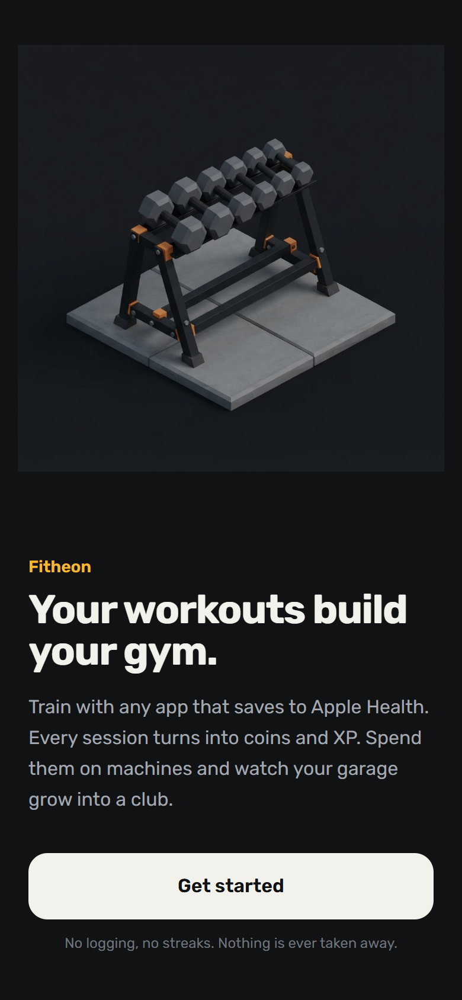
  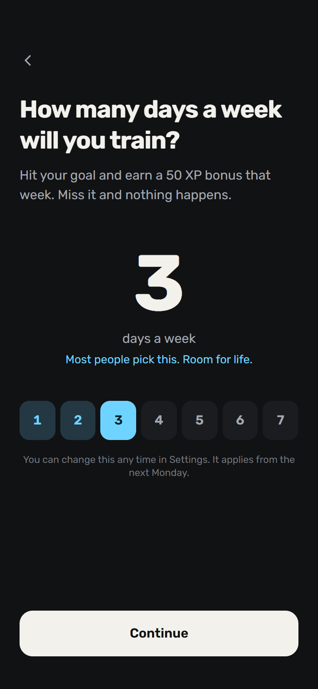
  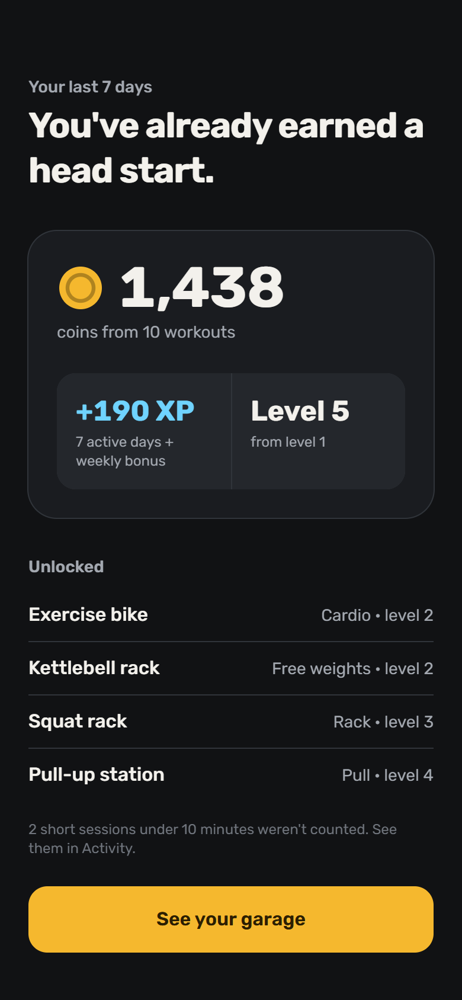
  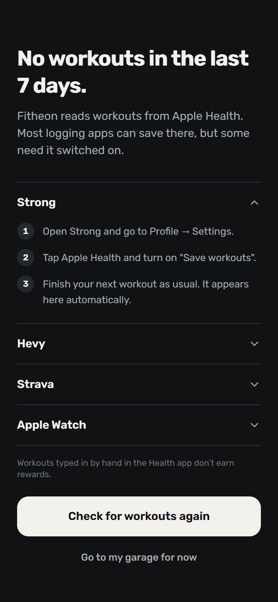

1. **Pozdrav:** kaj aplikacija počne.
2. **Tedenski cilj:** izbira števila aktivnih dni na teden.
3. **Povzetek uvoza:** treningi zadnjih 7 dni postanejo začetni kovanci in XP.
4. **Vodnik za nastavitev:** prikaže se namesto zaslona 3, kadar v Apple
   Health ni treningov.

## 2. Fitnes

  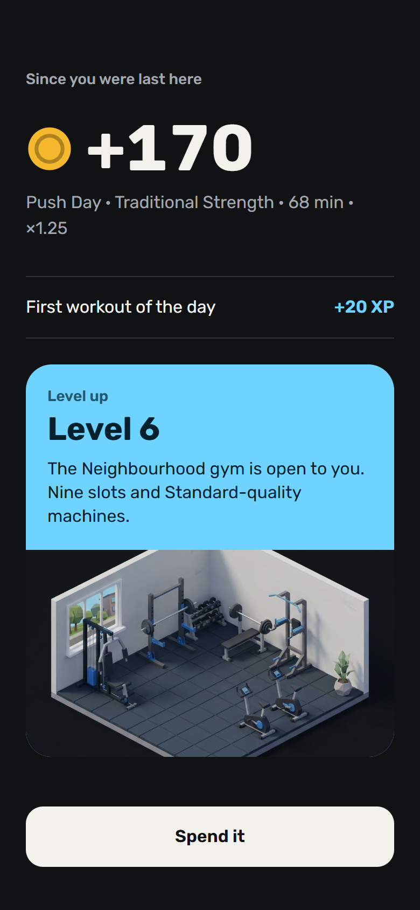
  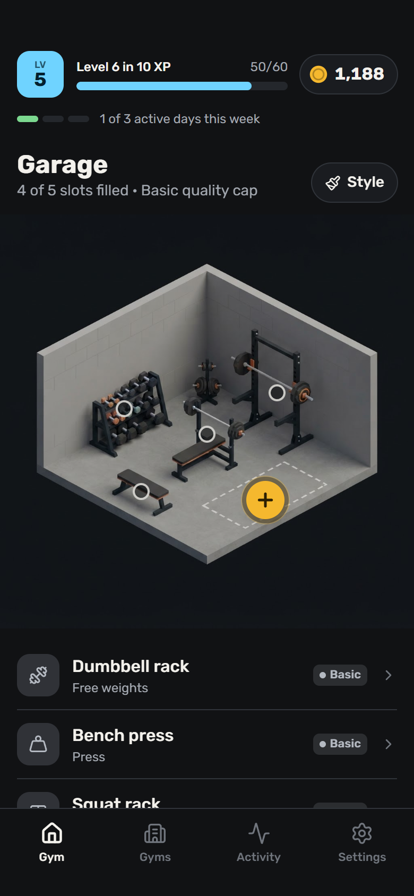
  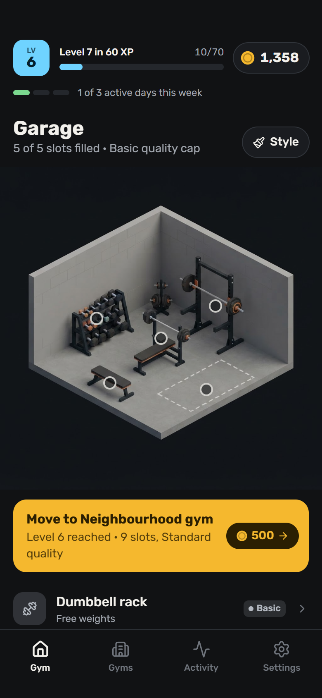
  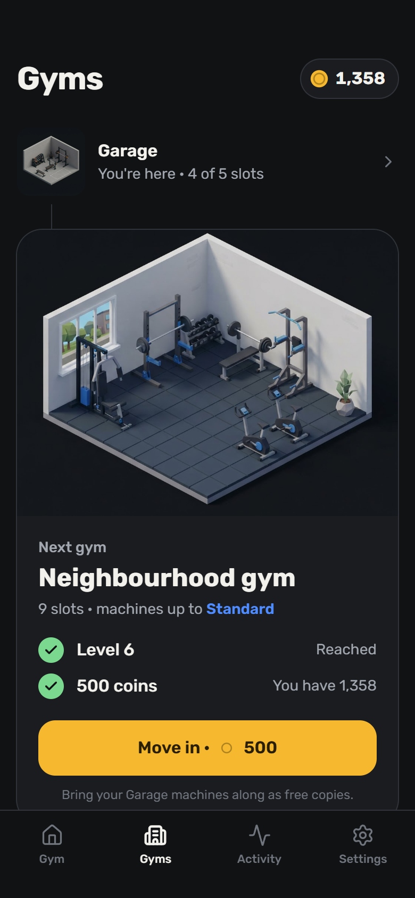

5. **Povzetek ob vrnitvi:** kaj je uporabnik zaslužil od zadnjega odprtja
   aplikacije.
6. **Fitnes:** domači zaslon z ravnjo, kovanci, tedenskim ciljem in mesti.
7. **Fitnes, naslednji odklenjen:** ko uporabnik doseže raven za naslednji
   fitnes, se pojavi pasica za selitev.
8. **Fitnesi:** vsi štirje fitnesi in zahteve za naslednjega.

## 3. Mesta in slog

  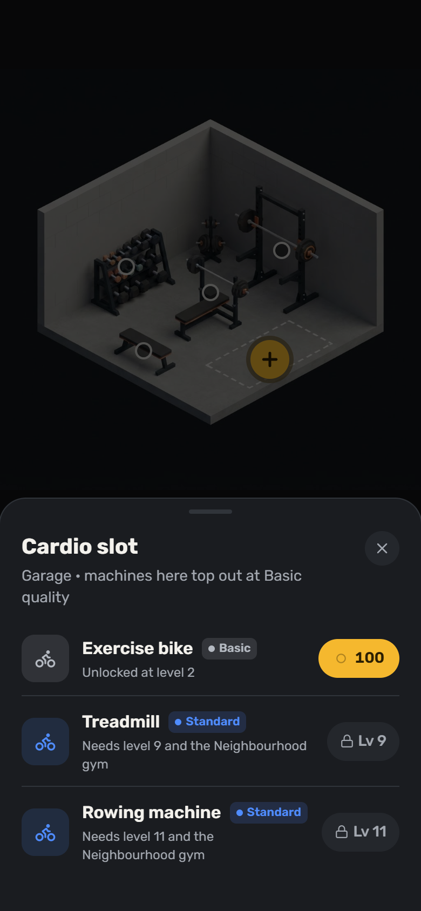
  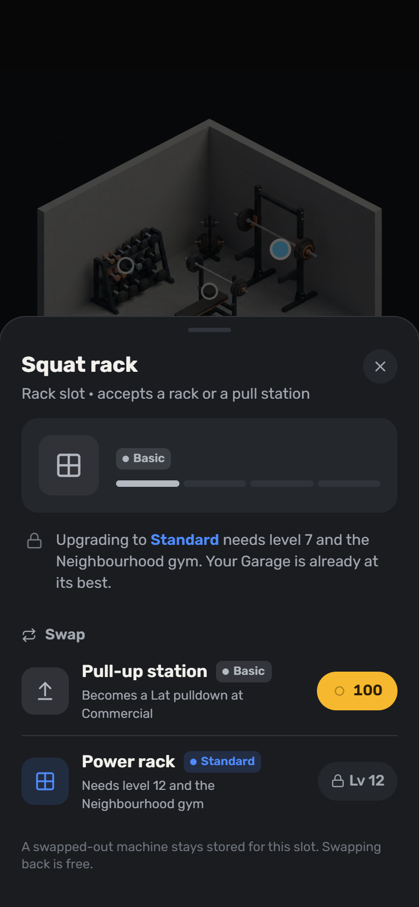
  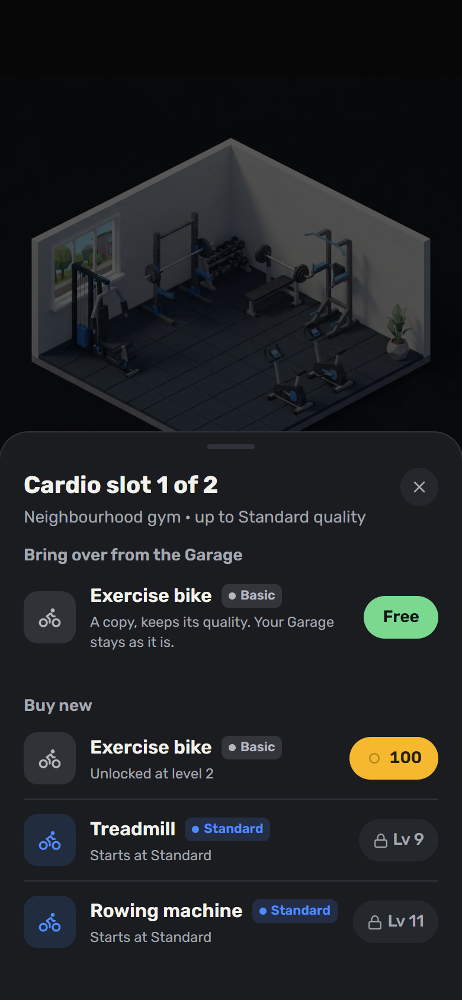
  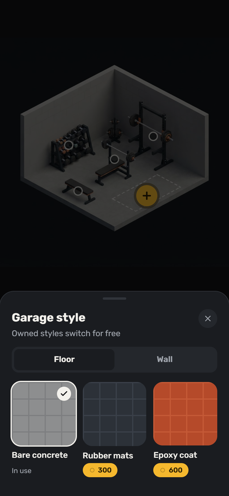

9. **Prazno mesto:** izbira naprave za nakup.
10. **Postavljena naprava:** kakovostna stopnja, pogoji nadgradnje in menjava.
11. **Prenos:** v novem fitnesu se naprava iz prejšnjega brezplačno prenese
    kot kopija.
12. **Slog:** slogi tal in sten.

## 4. Aktivnost in nastavitve

  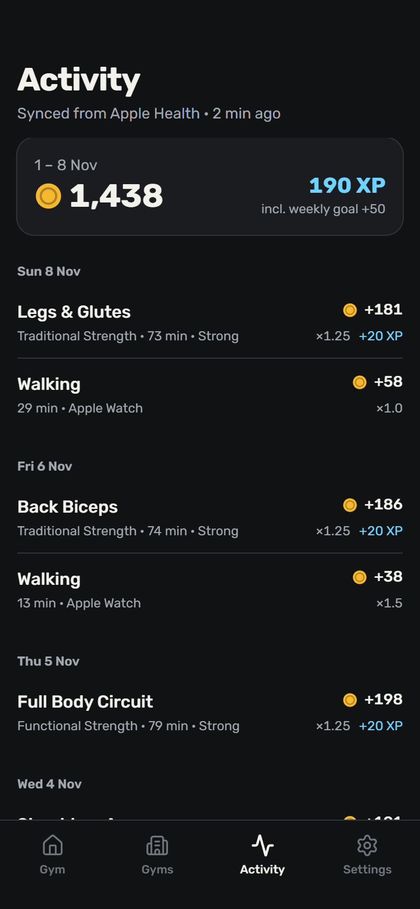
  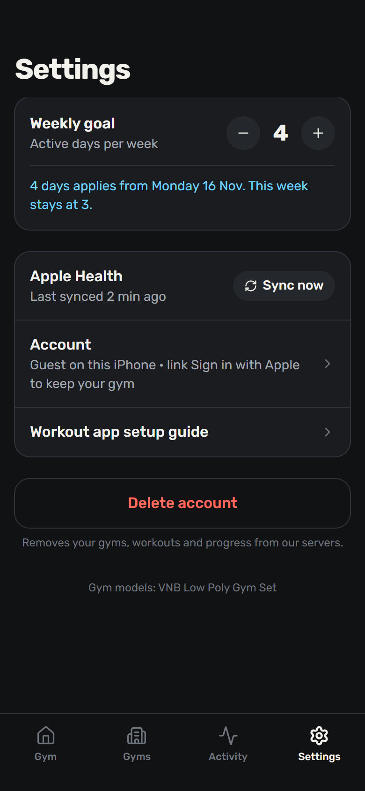

13. **Aktivnost:** vsak uvožen trening, kaj je prinesel in zakaj nekateri niso
    bili upoštevani.
14. **Nastavitve:** tedenski cilj, sinhronizacija z Apple Health in račun.