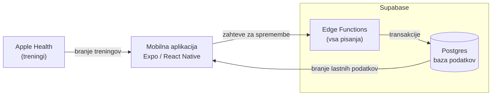
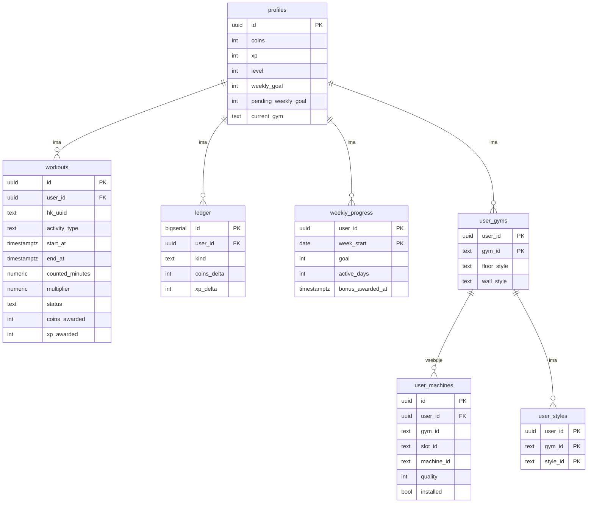

# Arhitektura

Dokument opisuje zgradbo sistema Fitheon, podatkovni model in uporabljene
tehnologije.

Vir: [Fitheon-Specification-v2.md](Fitheon-Specification-v2.md), poglavji 7
in 8.

## 1. Arhitekturni diagram

Sistem ima tri dele:

- **Apple Health** je vir podatkov. Vanj treninge zapisujejo ura Apple Watch
  in aplikacije, kot so Strong, Hevy in Strava. Fitheon iz njega samo bere.
- **Mobilna aplikacija** na iPhonu prebere nove treninge, jih pošlje strežniku
  in prikazuje fitnes.
- **Supabase** je zaledje: avtentikacija, baza Postgres in funkcije Edge
  Functions, ki izvajajo pravila igre.

### Pravilo pisanja

Aplikacija svoje podatke iz baze **bere neposredno**, vendar jih **nikoli ne
piše**. Vsaka sprememba (sinhronizacija treningov, nakup, nadgradnja, selitev)
gre skozi funkcijo Edge Function, ki pravila preveri na strežniku in spremembo
izvede v eni transakciji. Tako uporabnik ne more sam spremeniti stanja
kovancev ali ravni. Varnost na ravni vrstic (RLS) zagotavlja, da vsak
uporabnik vidi le svoje podatke.

### Skupna pravila igre

Pravila za nagrade ter katalog fitnesov, naprav in cen so v skupnih paketih
TypeScript. Ista koda teče v funkcijah Edge Functions, v testih in v
simulatorju ekonomije, zato se izračun nagrad nikjer ne podvaja.

| Paket | Namen |
|---|---|
| `packages/engine` | Pretvori treninge v kovance in XP |
| `packages/catalog` | Fitnesi, mesta, naprave, slogi in cene |
| `packages/game` | Stanje igre in dejanja igralca |
| `tools/sim` | Simulator ekonomije in orodje za ukazno vrstico |
| `mobile-app` | Mobilna aplikacija (Expo) |

### Strežniške funkcije

| Funkcija | Namen |
|---|---|
| `sync-workouts` | Sprejme treninge, uporabi pravila, dodeli kovance, XP, tedenski bonus in ravni. Ponovni klic istega treninga ne nagradi dvakrat. |
| `install-machine` | Nakup ali prenos naprave na mesto |
| `upgrade-machine` | Dvig postavljene naprave za eno kakovostno stopnjo |
| `swap-machine` | Menjava naprave na mestu |
| `buy-style` / `set-style` | Nakup ali preklop sloga tal oziroma sten |
| `move-gym` | Preveri raven in kovance ter odklene naslednji fitnes |
| `set-weekly-goal` | Shrani tedenski cilj, ki začne veljati naslednji ponedeljek |
| `delete-account` | Izbriše uporabnika in vse njegove podatke |

## 2. Podatkovni model

Baza Postgres ima sedem tabel. Katalog (fitnesi, mesta, naprave, cene) ni v
bazi, ampak v kodi; tabele hranijo le stanje posameznega uporabnika.

| Tabela | Vsebina |
|---|---|
| `profiles` | En zapis na uporabnika: kovanci, XP, raven, tedenski cilj in trenutni fitnes. Kovanci, XP in raven so predpomnjene vrednosti; vir resnice je `ledger`. |
| `workouts` | Vsak sinhroniziran trening z izračunano nagrado in statusom (`counted`, `below_min`, `daily_cap`, `overlap`, `user_entered`, `invalid`). Par (`user_id`, `hk_uuid`) je unikaten, zato se trening ne more zabeležiti dvakrat. |
| `ledger` | Knjiga vseh sprememb kovancev in XP, v katero se zapisi samo dodajajo: nagrade za treninge, tedenski bonusi, nakupi, nadgradnje, slogi, selitve. |
| `weekly_progress` | Napredek tedenskega cilja: cilj, število aktivnih dni in čas dodelitve bonusa za posamezen teden. |
| `user_gyms` | Fitnesi, ki jih je uporabnik odklenil, z izbranim slogom tal in sten. |
| `user_machines` | Vse naprave uporabnika po mestih, postavljene ali shranjene, z njihovo kakovostjo. Na enem mestu je lahko postavljena le ena. |
| `user_styles` | Slogi tal in sten, ki jih je uporabnik kupil. |

Zdravstveni podatki se hranijo v najmanjšem potrebnem obsegu: porabljena
energija, telesna masa in srčni utrip se na strežniku ne shranjujejo.

## 3. Tehnologije

| Področje | Tehnologija | Zakaj |
|---|---|---|
| Mobilna aplikacija | Expo (React Native), TypeScript, Expo Router | Razvoj za iPhone na sistemu Windows, brez računalnika Mac |
| Zaledje | Supabase: Auth, Postgres, Edge Functions | Avtentikacija, baza in strežniške funkcije v eni storitvi z brezplačnim paketom |
| Podatki o treningih | Apple Health (HealthKit) za vmesnikom `HealthSource` | Vmesnik omogoča razvoj z lažnimi (mock) podatki, preden je na voljo pravi HealthKit |
| Prijava | Anonimna prijava Supabase, pozneje Sign in with Apple | Uporabnik začne brez registracije |
| Pravila igre | Skupni paketi TypeScript (`engine`, `catalog`, `game`) | Ista koda v aplikaciji, na strežniku in v testih |
| Prikaz fitnesa | Vnaprej izrisane slike, zložene v plasti | Ni potrebe po igralnem pogonu |
| Stanje v aplikaciji | TanStack Query | Predpomnjenje in osveževanje podatkov s strežnika |
| Grafika | Blender, brezplačen paket 3D-modelov »VNB Low Poly Gym Set« | Izris naprav iz ene izometrične kamere |
| Testiranje | Vitest | Enotski testi pravil nagrajevanja in kataloga |
| Razvojno okolje | Node 22, npm workspaces, tsx | Monorepo s skupnimi paketi |

